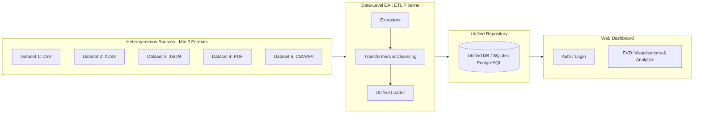

# Project Context: IAK Dashboard (Data-Level EAI)

Dashboard integrasi data heterogen berbasis web untuk tugas mata kuliah **Integrasi Aplikasi Korporat (IAK)** — FTMM Universitas Airlangga.

---

## 1. Core Requirements & Rubrik Penilaian

| Komponen | Bobot | Deskripsi & Target Teknis |
| :--- | :---: | :--- |
| **Laporan & Analisis** | **40%** | Dokumentasi arsitektur Data-Level EAI, langkah ETL detail, struktur skema gabungan, dan analisis insight mendalam dari visualisasi. |
| **Integrasi ETL** | **30%** | Pipeline Extract, Transform, Load otomatis dari **minimal 5 dataset** dengan **minimal 3 format berbeda** (e.g. CSV, XLSX, JSON, PDF) ke target database terpadu. |
| **Desain Website & Visualisasi** | **30%** | Antarmuka web responsif, UI/UX modern, visualisasi interaktif multi-dimensi (charts, filtering, drill-down), serta fitur otentikasi/login. |

---

## 2. Batasan Teknis & Aturan Proyek
1. **Tema Proyek**: **Pertambangan (Mining)** — Kelompok 6.
   - Target: Sektor pertambangan Indonesia (e.g. produksi/ekspor batu bara, nikel, emas, tembaga, minyak/gas bumi, PDB sektor pertambangan).
   - Sumber Data: BPS (`bps.go.id`), Kementerian ESDM, atau portal Open Data resmi.
2. **Format Sumber Data (Heterogen, min. 3 jenis, total min. 5 dataset)**:
   - Dataset 1: CSV
   - Dataset 2: XLSX / Excel
   - Dataset 3: JSON / REST API
   - Dataset 4: PDF (ekstraksi tabel laporan statistik resmi BPS / ESDM)
   - Dataset 5: CSV / XLSX / JSON
3. **Prinsip EAI**:
   - Menerapkan **Data-Level EAI**: data diekstraksi dari heterogenitas sumber (ekstraksi independen), dibersihkan (cleansing & harmonisasi satuan), dinormalisasi, dan diintegrasikan ke skema tunggal (*Unified Data Warehouse / Single Source of Truth*).
4. **Fitur Aplikasi**:
   - Sistem Autentikasi / Login (protected routes).
   - Dashboard EVD (*Exploratory Visual Dashboard*): KPI metrik, komparasi komoditas, tren tahunan, filter provinsi/wilayah.
   - Viewer Data Terintegrasi (tabel hasil ETL).
---

## 3. Architecture & Tech Stack



- **Python Toolchain**: Wajib menggunakan **`uv` (Astral)** untuk package & environment management (`uv init`, `uv add`, `uv run`).
- **ETL Engine**: Python (`pandas`, `openpyxl`, `pdfplumber`, `requests`, `sqlite3`).
- **Web App**:
  - Frontend: Dashboard modern responsif, Tailwind CSS, charting interaktif (Recharts / Chart.js).
  - Backend: FastAPI / Python API terintegrasi dengan auth session/JWT.
- **Data Store**: SQLite (`unified_mining.db`) sebagai representasi Unified Data-Level EAI.

---

## 4. Development Workflow & Quality Gates

### Siklus Eksekusi Wajib (Standard Execution Lifecycle)

Setiap agen yang menjalankan tugas WAJIB mematuhi 5 tahapan kerja berurutan berikut:

1. **Investigasi & Code Intelligence (CodeGraph First)**:
   - Repositori telah diindeks oleh CodeGraph (`.codegraph/`).
   - **WAJIB gunakan `codegraph_explore` (MCP) atau `codegraph explore "<query>"` (CLI)** SEBELUM menggunakan `grep`, `find`, atau membaca file manual untuk memetakan simbol, rute API, dan blast radius.
   - Gunakan `graphify` (`skill://graphify` / `graphify query`) jika butuh analisis arsitektur makro atau relasi lintas dataset/dokumen.

2. **Muat Skill & Rancang Low-Level To-Do List**:
   - **Baca Skill Terlebih Dahulu**: Wajib memuat `skill://<nama>` yang relevan sebelum menulis solusi:
     - `skill://karpathy-guidelines` (prinsip surgical changes, anti over-engineering).
     - `skill://antislop` (wajib untuk pengerjaan UI, styling, copy teks, dan evaluasi 3-state UI).
     - `skill://j-space` (penalaran bertahap & state preservation).
   - **Buat Low-Level To-Do List**: Pecah tugas menjadi checklist teknis yang konkret dan granular (nama file, fungsi/endpoint target, dan batasan implementasi), bukan rencana abstrak.

3. **Eksekusi Bertahap (Execute per Checklist)**:
   - Kerjakan implementasi satu per satu secara disiplin mengikuti to-do list.
   - Batasi perubahan hanya pada scope to-do aktif; hindari refactor liar atau abstraksi yang tidak diminta.

4. **Verifikasi & Validasi Hasil**:
   - Lakukan pengujian langsung (smoke run: jalankan server, script ETL, curl endpoint, atau cek UI) untuk membuktikan perubahan benar-benar berfungsi tanpa error.
   - Sinkronisasi indeks CodeGraph:
     ```bash
     codegraph sync .
     ```

5. **Atomic Commit dengan Rincian Jelas**:
   - Lakukan commit per unit pekerjaan logis (atomic commit, pisahkan modul/fitur yang tidak saling terikat).
   - Pesan commit wajib mencantumkan detail konkret:
     - Komponen/fitur yang diubah.
     - Ringkasan aksi (apa yang ditambah, dihapus, atau diperbaiki).

### Tahapan Kerja (Phased Roadmap)
- **Tahap 1: Pengumpulan & Standarisasi Dataset Pertambangan** (5 dataset, min 3 format berbeda, simpan di `data/raw/`).
- **Tahap 2: Implementasi Pipeline ETL (Data-Level EAI)** (ekstraksi heterogen, cleansing, skema `unified_mining.db`, simpan di `data/processed/`).
- **Tahap 3: Backend API & Autentikasi** (endpoint analitik pertambangan, handler login/auth).
- **Tahap 4: Frontend Web Dashboard EVD** (UI interaktif, filter multi-dimensi, charting responsif).
- **Tahap 5: Laporan & Dokumentasi EAI** (arsitektur Data-Level EAI, dokumentasi ETL, analisis insight data pertambangan).
<!-- antislop:start -->
## antislop
For UI, copy, people, mobile layout, or code comments work, read `skill://antislop`.
Automatically read and apply immediately when starting writing or UI work. Never ask whether to read or when it applies.
<!-- antislop:end -->

